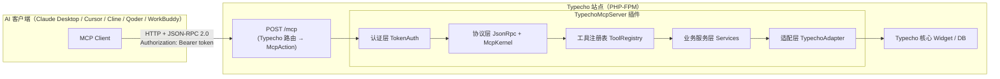
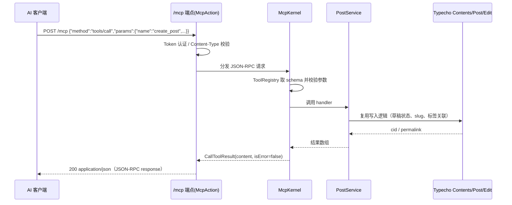

# Typecho MCP Server 技术设计方案

| 项目 | 内容 |
| --- | --- |
| 项目名称 | typecho-mcpserver |
| 版本 | v1.0（设计稿） |
| 目标读者 | 项目开发者、协作 AI Agent |

---

## 1. 背景与目标

### 1.1 背景

Typecho 是一个轻量级开源博客程序，广泛部署于个人博客场景。随着 AI Agent 的普及，用户希望直接通过自然语言让 AI 完成博客内容管理（写文章、建页面、整理分类标签等），而无需人工登录后台操作。

MCP（Model Context Protocol）是 Anthropic 提出的开放协议，为 AI 应用连接外部数据源和工具提供了标准化方式，已被 Claude Desktop、Cursor、Cline 等主流 AI 客户端支持。

本项目将 Typecho 的内容管理能力封装为 MCP Server，暴露给任意支持 MCP 协议的 AI Agent 使用。

### 1.2 目标

1. AI Agent 通过 MCP 协议完成 Typecho 内容管理：撰写文章、创建页面、编辑文章、管理分类、管理标签；
2. **安全默认**：新文章默认保存为草稿，不直接发布（产品级约束，见 5.2）；
3. **安装即用**：以 Typecho 插件形式交付，上传启用即可，无需额外服务器进程、无需 Composer 依赖；
4. **版本兼容**：仅支持 Typecho 1.3.0，不兼容 1.2.x 及其他版本；运行环境适配 PHP 8.3；
5. 兼容主流 MCP 客户端（Claude Desktop、Cursor、Cline、Qoder CN、WorkBuddy 等）的远程接入方式。

### 1.3 非目标（Out of Scope）

- 不做评论管理、用户管理、附件上传（列入后续迭代候选）；
- 不提供 stdio 传输形态（附录 A 记录了该备选方案及放弃理由）；
- 不实现 MCP 的 Sampling、Roots、Elicitation 等客户端侧能力；
- 不做多博客聚合管理。

---

## 2. 需求分析

### 2.1 功能需求 → MCP Tools 映射

原始接口清单（README）：

| # | 需求 | 对应 MCP Tools | 优先级 |
| --- | --- | --- | --- |
| 1 | 撰写文章（默认草稿） | `create_post` | P0 |
| 2 | 编辑文章 | `update_post` | P0 |
| 3 | 创建页面 | `create_page` | P1 |
| 4 | 管理分类 | `list_categories` / `create_category` / `update_category` / `delete_category` | P0 查询 / P1 写入 |
| 5 | 管理标签 | `list_tags` / `create_tag` / `update_tag` / `delete_tag` | P0 查询 / P1 写入 |

**补充的支撑性工具**（AI 无法凭空获得 cid/mid 等主键，必须先可查询）：

| Tool | 用途 | 优先级 |
| --- | --- | --- |
| `list_posts` | 分页查询文章（状态/关键词过滤），获取 cid | P0 |
| `get_post` | 读取文章详情（正文、分类、标签、状态） | P0 |
| `get_site_info` | 站点基本信息，帮助 AI 理解上下文 | P1 |
| `delete_post` | 删除文章（默认关闭，需配置开启） | P2 |
| `update_page` | 编辑页面 | P2 |

### 2.2 非功能需求

| 类别 | 要求 |
| --- | --- |
| 安全 | Token 认证；发布/删除等高危操作独立开关；操作审计日志 |
| 兼容 | 仅支持 Typecho 1.3.0（不兼容 1.2.x 及以下）；运行环境主目标 **PHP 8.3**（最低跟随 Typecho 1.3.0 的 PHP ≥ 7.4），代码规避 8.2+ 弃用特性（动态属性、`${var}` 字符串插值等） |
| 协议 | MCP Streamable HTTP（无状态 JSON 模式），协议版本支持 2024-11-05 / 2025-03-26 / 2025-06-18 |
| 部署 | 零 Composer 依赖、零常驻进程，兼容虚拟主机 / 宝塔 / Docker 等 PHP 部署形态（FPM 与 Apache mod_php 均可） |
| 性能 | 单请求全链路 < 300ms（本地环境），tools/list 响应 < 10KB |

---

## 3. 技术选型

### 3.1 实现形态对比与决策

| 方案 | 形态 | 优点 | 缺点 | 结论 |
| --- | --- | --- | --- | --- |
| A | 独立 PHP CLI 进程（stdio），基于 php-mcp/server SDK，经 XML-RPC 调用 Typecho | SDK 成熟；协议层零开发 | 需常驻进程，虚拟主机不可用；XML-RPC 不支持标签管理等操作，能力受限；用户需独立部署 | 备选（附录 A） |
| B | **Typecho 插件内嵌 MCP 端点（Streamable HTTP 无状态模式）** | 安装即用；直接复用 Typecho 内部 Widget API，能力全覆盖；无额外进程 | 需自研轻量协议层（JSON-RPC 2.0 分发，约 300 行） | **采用** |
| C | Node.js 独立服务，调用 Typecho XML-RPC | MCP 官方 TS SDK 最成熟 | 引入异构运行时，部署成本最高；同样受 XML-RPC 能力限制 | 放弃 |

**决策理由**：目标用户是 Typecho 博客主（普遍使用虚拟主机/宝塔的 PHP-FPM 环境），"上传插件即可用"是产品竞争力的核心；Typecho 内置 XML-RPC（MetaWeblog API）缺少标签管理、页面管理等能力，无法完整覆盖需求，故必须走插件内部 API 路线。

### 3.2 MCP 传输协议：无状态 Streamable HTTP

MCP 2025-03-26 规范定义的 Streamable HTTP 传输允许服务器以**无状态 JSON 模式**工作：

- 客户端统一 `POST` 到单一端点（本项目为 `/mcp`），请求体为 JSON-RPC 2.0；
- 服务器可直接返回 `Content-Type: application/json` 的 JSON-RPC 响应，**不要求** SSE 长连接与会话保持；
- 该模式与 PHP-FPM 的短请求生命周期天然契合，规避了 FPM 无法维持 SSE 长连接的问题；
- php-mcp/server 等现有 PHP SDK 的 HTTP 传输基于 ReactPHP 常驻进程实现，无法运行于 FPM，故协议层自研（零依赖）。

### 3.3 依赖策略

**零 Composer 依赖**：插件目录内自带 `src/` 自动加载器（`spl_autoload_register`），全部代码纯 PHP，主目标与验证环境为 **PHP 8.3**（最低跟随 Typecho 1.3.0 的 PHP ≥ 7.4）。理由：Typecho 插件生态不标配 Composer；目标环境（虚拟主机）普遍无 CLI 权限；协议子集实现量小，自研成本低于引入依赖的部署成本。

---

## 4. 总体架构

### 4.1 架构图



### 4.2 请求时序（以 `create_post` 为例）



### 4.3 模块职责

| 模块 | 文件 | 职责 |
| --- | --- | --- |
| 插件主体 | `Plugin.php` | activate/deactivate（注册路由 `/mcp`）、配置表单、Token 生成 |
| MCP 端点 | `Action.php` | HTTP 层：方法/头校验、认证、响应输出（200/401/405/415） |
| 协议层 | `src/Protocol/*` | JSON-RPC 2.0 解析/封装、MCP 方法分发（initialize、tools/list、tools/call、ping）、协议版本协商 |
| 工具注册表 | `src/Tools/ToolRegistry.php` | 工具元数据（名称、描述、inputSchema、handler）集中注册与查找 |
| 业务服务层 | `src/Services/*` | 文章/页面/分类/标签/站点/附件六个领域服务，隔离 Typecho 内部调用细节 |
| 适配层 | `src/Support/TypechoAdapter.php` | Typecho 1.3.0 Widget 实例化统一封装（`Typecho\Widget::widget()`、`Utils\Helper`、命名空间类名） |
| 认证 | `src/Auth/TokenAuth.php` | Bearer Token / URL Token 双通道校验 |
| 日志 | `src/Support/Logger.php` | 调用审计日志（写自建表，环形截断） |

---

## 5. 详细设计

### 5.1 MCP 协议层

#### 5.1.1 端点与 HTTP 语义

插件激活时注册路由：`Helper::addRoute('mcp', '/mcp', 'TypechoPlugin\TypechoMcpServer\Action', 'action')`。

| HTTP 请求 | 行为 |
| --- | --- |
| `POST /mcp`（`Accept: application/json`，Body 为单个 JSON-RPC 或批量数组） | 认证通过后进入协议分发，返回 JSON 响应 |
| `GET /mcp` | `405`（无状态模式不提供 SSE 流） |
| `DELETE /mcp` | `405`（无会话可终结） |
| `Content-Type` 非 `application/json` | `415` |
| Token 缺失/错误 | `401` |
| JSON 解析失败 / 非法 JSON-RPC | `400`（JSON-RPC error code -32700 / -32600） |

> 路由 URL 可在插件配置中自定义（如 `/api/mcp`），以规避与既有路由/主题的冲突。

#### 5.1.2 支持的 JSON-RPC 方法

| 方法 | 处理 |
| --- | --- |
| `initialize` | 返回 `protocolVersion`（协商值）、`capabilities: {tools: {listChanged: false}}`、`serverInfo`；无状态模式下不签发 `Mcp-Session-Id` |
| `notifications/initialized` 等通知 | 返回 `202 Accepted`（无 body） |
| `tools/list` | 从 ToolRegistry 生成全部工具描述（含 inputSchema）；支持 `cursor` 分页参数（首版单页返回） |
| `tools/call` | 校验 name/参数 → 调用 handler → 组装 `content[]`；业务异常时 `isError: true` + 错误文本（**不**用 JSON-RPC error，符合规范对工具执行错误的约定） |
| `ping` | 返回空 result |
| 其他 | JSON-RPC error `-32601 Method not found` |

#### 5.1.3 协议版本协商

`initialize.params.protocolVersion` 为已知版本（`2024-11-05` / `2025-03-26` / `2025-06-18`）时原样回显；未知版本回显服务器最新支持版本 `2025-06-18`。

#### 5.1.4 工具结果内容形态

统一返回 `content: [{type: "text", text: "<JSON string>"}]`，结构化结果放入 `structuredContent`（对支持 2025-06-18 的客户端）并保持 text 中含相同 JSON，保证旧客户端可用。

### 5.2 认证与安全

#### 5.2.1 Token 认证

- 插件激活时生成 48 位随机 Token（`bin2hex(random_bytes(24))`）存入插件配置，后台可一键重置；
- 双通道传递（兼顾不便设置请求头的客户端）：
  - `Authorization: Bearer <token>`（推荐）；
  - `GET` 参数 `?token=<token>`（配置项可关闭 URL 通道，防 Token 进入访问日志）；
- 校验使用 `hash_equals` 防时序攻击。

#### 5.2.2 权限与操作身份

- 插件配置中选择**执行身份**（绑定一个 Typecho 用户，默认站长），所有写操作以该身份落库（作者字段、`authorId` 正确归属）；
- **高危操作开关**（独立控制，均默认关闭）：

| 配置项 | 默认 | 作用 |
| --- | --- | --- |
| `allowPublish` | 关 | `create_post`/`update_post`/`create_page` 的 status 是否允许设为非 draft 值 |
| `allowDelete` | 关 | `delete_post`、`delete_category`、`delete_tag` 是否可用 |
| `autoCreateCategory` | 开 | 写文章时分类不存在是否自动创建 |
| `urlTokenEnabled` | 开 | 是否允许 URL 传递 Token |

#### 5.2.3 防误发布约束（需求 1 的落地）

- `create_post` 的 `status` 参数默认值 `draft`；
- `allowPublish=false` 时传入非 `draft` 值 → 返回 `isError: true`，提示"出于安全策略，请到 Typecho 后台人工发布"；
- `update_post` 将 draft 改为 publish 同样受 `allowPublish` 约束。

#### 5.2.4 其他安全措施

- 响应头输出基本 CORS 策略（默认仅同域，配置项可放开指定 Origin——供网页端 MCP 客户端接入）；
- 文档强烈建议开启 HTTPS（Token 明文传输风险）；
- 审计日志记录每次 `tools/call`（见 5.6）。

### 5.3 Typecho 1.3.0 与 PHP 8.3 适配

**适配基线**：仅支持 Typecho 1.3.0，不适配 1.2.x 及以下版本。

| 适配点 | 1.3.0 基线 | 本项目做法 |
| --- | --- | --- |
| 插件主类 | 命名空间风格 `TypechoPlugin\<PluginName>\Plugin`，实现 `Typecho\Plugin\PluginInterface` | 主类采用 1.3 命名空间风格 |
| Widget 类名 | 命名空间风格（`Widget\Contents\Post\Edit` 等） | Service 层直接使用命名空间类名，经 `TypechoAdapter::widget()` 统一实例化（封装 `Typecho\Widget::widget()`） |
| Helper | `Utils\Helper`（全局 `Helper` 保留别名） | 统一使用 `Utils\Helper` |
| 插件 Action 类 | `TypechoPlugin\<PluginName>\Action` | 路由注册指向该类（见 5.1.1） |

**PHP 8.3 适配要点**（运行环境主目标 PHP 8.3，最低跟随 Typecho 1.3.0 的 PHP ≥ 7.4）：

- 规避 8.2+ 弃用特性：不使用动态属性（确需挂载额外状态时显式声明属性或标记 `#[AllowDynamicProperties]`）、不使用 `${var}` 字符串插值；
- 不向非可空内置函数参数传 null（8.1+ 弃用，8.3 下告警升级）；
- 依赖函数（`random_bytes`、`hash_equals`、`json_decode` flags、`spl_autoload_register`）在 8.3 下行为无变化，Spike 阶段统一复核；
- 测试链路 PHPUnit 10+（对 PHP 8.3 提供原生支持）；
- CI 与集成环境镜像统一 `php:8.3-apache`（Apache + mod_php，贴近 Typecho 官方容器形态）。

**开发前 Spike 任务**（排入 P0 第一天，目标环境 Typecho 1.3.0 + PHP 8.3）：

1. 验证 `Widget\Contents\Post\Edit` 的可复用写入方法签名与必要上下文（XML-RPC 的 `Widget\XmlRpc` 即通过该 Widget 落库，需确认其调用方式）；
2. 验证 `Widget\Metas\Category\Edit` / `Widget\Metas\Tag\Edit` 的增删改方法可否脱离后台 request 上下文复用；若耦合过深，Service 层降级为直接操作 `metas`/`contents`/`relationships` 表（补充必要钩子触发，保证缓存与 slug 唯一性逻辑）。

### 5.4 业务服务层

| Service | 依赖的 Typecho 能力 | 关键逻辑 |
| --- | --- | --- |
| `PostService` | Contents/Post/Edit 写入、Contents 查询 | 草稿创建、slug 冲突处理（自动加 `-1` 后缀）、标签关联（自动建标签）、分类关联（可选自动建） |
| `PageService` | Contents/Page/Edit 写入 | 页面即 `type=page` 的 content；模板/排序字段透出 |
| `CategoryService` | Metas Category Edit / Metas 查询 | mid 主键；删除时处理文章归属（移至默认分类或拒绝删除，跟随 Typecho 原生行为） |
| `TagService` | Metas Tag Edit / Metas 查询 | mid 主键；重名合并策略（跟随原生行为） |
| `SiteService` | Options / Stat | 站点名、描述、文章/分类/标签计数、时区 |

通用约定：

- 输入的 `category`/`tags` 一律按**名称**传递（对 AI 友好），Service 层负责名称 ↔ mid 解析；解析失败按配置决定报错或自动创建；
- `created` 时间参数接受 ISO 8601 字符串，Service 层按站点时区转 Typecho 的时间戳约定；
- 所有写操作成功后返回：主键（cid/mid）、后台编辑链接（如 `/admin/write-post.php?cid=123`）、前台预览链接，便于人类跟进。

### 5.5 插件配置表单（config）

| 字段 | 类型 | 说明 |
| --- | --- | --- |
| `token` | text + 重置按钮 | API Token（只读展示 + 重新生成） |
| `bindUid` | select | 执行身份（用户下拉，默认站长） |
| `allowPublish` / `allowDelete` / `autoCreateCategory` / `urlTokenEnabled` | checkbox | 见 5.2.2 |
| `routePath` | text | 端点路径，默认 `/mcp`，仅数字字母连字符 |
| `logEnabled` | checkbox | 审计日志开关 |

配置页同时承担**使用说明**职责（需求落地见下节）。

#### 5.5.1 使用说明区（配置页顶部静态内容）

配置页第一屏以只读信息块形式向用户展示使用方法，内容包括：

1. **接入信息**：完整 MCP 端点 URL（站点地址 + 配置的 `routePath` 拼接而成）与当前 Token，各附一键复制按钮；
2. **客户端配置示例**：Claude Desktop / Cursor / Cline / Qoder CN / WorkBuddy 五种主流客户端的 JSON 配置片段（Token 已自动填充），一键复制；
3. **操作步骤指引**：三步说明——「① 复制上方配置片段 → ② 粘贴到 AI 客户端的 MCP 设置并启用 → ③ 在对话中让 AI 查询/撰写/管理博客内容」；
4. **安全提示**：Token 须保密、建议启用 HTTPS、当前发布/删除开关状态及其含义（如「发布开关当前关闭：AI 创建的文章均为草稿，需到后台人工发布」）；
5. 各配置项均带 `description` 说明文字，明确开关的生效范围与默认值。

实现方式：利用 Typecho 表单元素的 `description` 属性输出字段说明；接入信息与步骤指引由配置页模板以只读 HTML 信息块输出（纯 PHP 渲染，无外部依赖），信息内容随配置实时生成。

### 5.6 审计日志

自建表 `typecho_mcpserver_logs`（见第 7 节）。每次 `tools/call` 记录：时间、客户端 IP、工具名、参数摘要（正文截断 200 字）、结果状态、错误信息、耗时。环形保留最近 500 条（插入后删除超限旧记录），后台面板查看（P1 交付）。

---

## 6. MCP Tools 规格

### 6.1 工具总表

| Tool | 方向 | 优先级 | 摘要 |
| --- | --- | --- | --- |
| `list_posts` | 读 | P0 | 分页/状态/关键词查询文章列表 |
| `get_post` | 读 | P0 | 文章详情（cid、状态、分类、标签、正文） |
| `create_post` | 写 | P0 | 创建文章，默认草稿 |
| `update_post` | 写 | P0 | 编辑文章（含状态变更，受 `allowPublish` 约束） |
| `list_categories` | 读 | P0 | 分类列表（mid、名称、slug、计数） |
| `list_tags` | 读 | P0 | 标签列表（mid、名称、计数） |
| `create_page` | 写 | P1 | 创建页面，默认草稿 |
| `create_category` | 写 | P1 | 新建分类（名称、slug、父级、描述） |
| `update_category` | 写 | P1 | 编辑分类 |
| `delete_category` | 写 | P1 | 删除分类（受 `allowDelete`） |
| `create_tag` | 写 | P1 | 新建标签 |
| `update_tag` | 写 | P1 | 编辑标签 |
| `delete_tag` | 写 | P1 | 删除标签（受 `allowDelete`） |
| `get_site_info` | 读 | P1 | 站点信息与统计 |
| `delete_post` | 写 | P2 | 删除文章（受 `allowDelete`，默认禁用） |
| `update_page` | 写 | P2 | 编辑页面 |
| `upload_attachment` | 写 | P1 | 上传附件到媒体库（Base64 内容，复用 `Widget\Upload::uploadHandle` 与扩展名白名单）；仅上传，不提供附件删除 |

### 6.2 代表性 inputSchema：`create_post`

```json
{
  "type": "object",
  "properties": {
    "title":       { "type": "string",  "description": "文章标题" },
    "content":     { "type": "string",  "description": "Markdown 正文" },
    "slug":        { "type": "string",  "description": "自定义缩略名(URL)，留空自动生成" },
    "status":      { "type": "string",  "enum": ["draft", "publish", "hidden", "password", "private"],
                     "default": "draft", "description": "默认 draft；非 draft 需站点开启 allowPublish" },
    "password":    { "type": "string",  "description": "status=password 时的访问密码" },
    "category":    { "type": "string",  "description": "分类名称（单个）；不存在时按配置自动创建" },
    "tags":        { "type": "array",   "items": { "type": "string" }, "description": "标签名称列表" },
    "excerpt":     { "type": "string",  "description": "摘要，留空自动截取" },
    "created":     { "type": "string",  "description": "发布时间 ISO 8601，如 2026-11-14T09:00:00+08:00" },
    "allowComment":{ "type": "boolean", "default": true, "description": "是否允许评论" }
  },
  "required": ["title", "content"]
}
```

### 6.3 代表性响应：`create_post` 成功

```json
{
  "content": [{ "type": "text", "text": "{\"cid\": 128, \"status\": \"draft\", ...}" }],
  "structuredContent": {
    "cid": 128,
    "status": "draft",
    "title": "示例文章",
    "adminEditUrl": "https://blog.example.com/admin/write-post.php?cid=128",
    "message": "已保存为草稿，请到后台确认发布"
  },
  "isError": false
}
```

### 6.4 其余工具参数要点

| Tool | 关键参数 | 备注 |
| --- | --- | --- |
| `list_posts` | `page`、`pageSize`(≤50)、`status`(all/draft/publish/hidden/private)、`keyword`(标题/正文模糊) | 返回 cid、标题、状态、分类、标签、时间 |
| `get_post` | `cid` | 返回完整正文（Markdown 源） |
| `update_post` | `cid` + 6.2 中任意可选字段（仅传变更项） | status 变更受 `allowPublish` 约束 |
| `create_page` / `update_page` | 同文章，另含 `template`(模板)、`order`(排序) | |
| `create_category` | `name`*、`slug`、`parentId`、`description` | |
| `update_category` | `mid`* + 可选字段 | |
| `create_tag` | `name`*、`slug` | |
| `get_site_info` | 无 | 站点名/描述/URL/时区/统计计数/插件开关状态（让 AI 知晓能否发布） |
| `upload_attachment` | `filename`*（含扩展名）、`content_base64`*（可含 data URL 前缀）、`title`、`description`、`parentId`（关联内容 cid） | 返回附件 cid、访问 URL、mime、isImage；扩展名须在 `allowedAttachmentTypes` 内；仅上传不提供删除 |

---

## 7. 数据库设计

除自建日志表外，不新增表、不修改既有表结构。

```sql
CREATE TABLE IF NOT EXISTS `typecho_mcpserver_logs` (
  `id`      INT UNSIGNED AUTO_INCREMENT PRIMARY KEY,
  `time`    INT UNSIGNED NOT NULL,              -- 时间戳
  `ip`      VARCHAR(64)  NOT NULL DEFAULT '',
  `tool`    VARCHAR(64)  NOT NULL,
  `args`    VARCHAR(255) NOT NULL DEFAULT '',   -- 参数摘要（脱敏、截断）
  `ok`      TINYINT(1)   NOT NULL DEFAULT 0,
  `error`   VARCHAR(255) NOT NULL DEFAULT '',
  `costMs`  SMALLINT UNSIGNED NOT NULL DEFAULT 0,
  INDEX (`time`)
) ENGINE=InnoDB DEFAULT CHARSET=utf8mb4;
```

安装器兼容 Typecho 的 `Db::get()` 前缀机制（`__prefix__mcpserver_logs`），并同时适配 MySQL / SQLite / PostgreSQL（跟随 Typecho 已支持的驱动，使用其 Query Builder 建表，SQLite 下以等效类型建表）。

---

## 8. 项目目录结构

```
typecho-mcpserver/                     # 仓库根 = 插件发布包
├── Plugin.php                         # 插件主类（1.3 命名空间风格：TypechoPlugin\TypechoMcpServer\Plugin）
├── Action.php                         # MCP HTTP 端点（TypechoPlugin\TypechoMcpServer\Action::action()）
├── autoloader.php                     # src/ 的 spl_autoload_register 引导
├── src/
│   ├── Protocol/
│   │   ├── JsonRpc.php                # 请求解析、响应/错误封装、批量处理
│   │   └── McpKernel.php              # initialize / tools/list / tools/call / ping 分发
│   ├── Tools/
│   │   ├── ToolRegistry.php           # 工具元数据注册与查找
│   │   └── ToolDefinition.php         # name/description/inputSchema/handler 值对象
│   ├── Services/
│   │   ├── PostService.php
│   │   ├── PageService.php
│   │   ├── CategoryService.php
│   │   ├── TagService.php
│   │   ├── SiteService.php
│   │   └── MediaService.php        # 附件上传（仅上传，无删除）
│   ├── Auth/
│   │   └── TokenAuth.php
│   └── Support/
│       ├── TypechoAdapter.php         # Typecho 1.3.0 Widget 实例化统一封装
│       ├── Logger.php                 # 审计日志
│       └── Config.php                 # 插件配置读取（含开关判定）
├── README.md                          # 面向用户的安装/接入文档
├── 技术设计方案.md
└── tests/                             # PHPUnit（仅开发期，发布包剔除或保留无害）
    ├── Protocol/JsonRpcTest.php
    └── Tools/SchemaTest.php           # 全部 inputSchema 的 JSON Schema 合法性校验
```

---

## 9. 客户端接入示例

各客户端均通过远程 MCP（Streamable HTTP）接入，接入信息（URL + Token）可在插件配置页一键复制（见 5.5.1）。

### 9.1 Claude Desktop / Cursor / Cline

```json
{
  "mcpServers": {
    "typecho": {
      "url": "https://blog.example.com/mcp",
      "headers": { "Authorization": "Bearer <TOKEN>" }
    }
  }
}
```

### 9.2 Qoder CN

编辑用户级 `~/.mcp.json`（或项目级 `.qoder/mcp.json`），HTTP 传输使用 `url` + `headers`：

```json
{
  "mcpServers": {
    "typecho": {
      "url": "https://blog.example.com/mcp",
      "headers": { "Authorization": "Bearer <TOKEN>" }
    }
  }
}
```

### 9.3 WorkBuddy

编辑用户级 `~/.workbuddy/mcp.json`（或项目级 `<项目>/.workbuddy/mcp.json`），`type` 指定 `http`，密钥经 URL 通道传递：

```json
{
  "mcpServers": {
    "typecho": {
      "type": "http",
      "url": "https://blog.example.com/mcp?token=<TOKEN>",
      "description": "Typecho 博客内容管理"
    }
  }
}
```

不支持自定义 Header 的其他客户端，同样可使用 URL 通道：

```
https://blog.example.com/mcp?token=<TOKEN>
```

---

## 10. 测试方案

| 层次 | 工具 | 内容 |
| --- | --- | --- |
| 单元测试 | PHPUnit 10 | JsonRpc 解析/错误码/批量、ToolRegistry schema 合法性、TokenAuth（hash_equals 路径）、TypechoAdapter widget 解析 |
| 协议合规 | MCP Inspector（`npx @modelcontextprotocol/inspector`） | initialize 版本协商、tools/list、tools/call 全工具遍历、错误形态 |
| 集成测试 | 本地 Docker：`php:8.3-apache` + Typecho 1.3.0 | 路由注册、草稿落库、分类标签关联、401/405/415 语义 |
| 端到端 | Claude Desktop / Cursor / Qoder / WorkBuddy 实连 | 自然语言任务流："写一篇xx文章存草稿"、"把cid=5的文章改标题"、"列出所有分类" |
| 安全用例 | 脚本 | 错误 Token、URL 通道关闭、allowPublish=false 传 publish、Token 重置后旧 Token 失效 |

---

## 11. 开发计划与里程碑

| 阶段 | 周期 | 交付物 |
| --- | --- | --- |
| P0 Spike | 3 天 | 5.3 Spike 结论（1.3.0 Widget 复用可行性）；确认 Service 层复用/直写路线 |
| P0 MVP | 2 周 | 协议层 + 认证 + `list_posts` / `get_post` / `create_post` / `update_post` / `list_categories` / `list_tags`；Inspector 全绿；集成测试通过（Typecho 1.3.0 + PHP 8.3） |
| P1 | 1.5 周 | `create_page` + 分类/标签全部写入工具 + `get_site_info` + 审计日志与后台面板 |
| P2 | 1 周 | `delete_post` / `update_page`、限流、CORS 配置、README 用户文档定稿、发布 v1.0 |

---

## 12. 风险与应对

| # | 风险 | 影响 | 应对 |
| --- | --- | --- | --- |
| 1 | 1.3.0 内部 Edit Widget 与 request 上下文耦合过深，无法在 MCP 请求中复用 | P0 延期 | Spike 前置验证；兜底方案为 Service 层直写数据表并手工触发关键钩子（slug 唯一性、缓存刷新） |
| 2 | 用户在 Typecho 1.2.x 或更低版本上安装，插件无法激活 | 用户受阻 | 插件头注释与 README 明示环境要求（Typecho 1.3.0+、PHP 8.x 推荐）；激活报错信息引导升级 |
| 3 | Token 泄漏导致站点被写 | 安全事故 | 文档强制建议 HTTPS；一键重置；审计日志可溯源；高危开关默认全关 |
| 4 | AI 客户端对无状态 JSON 模式兼容性参差 | 接入失败 | Inspector + 五大客户端实测清单；保留 `?token=` 兜底通道 |
| 5 | 虚拟主机禁用自定义路由 / 伪静态缺失 | 端点 404 | 配置项支持改用 `/action/mcp`（Helper::addAction 形态）作为备用端点 |
| 6 | AI 误操作（改错文章、删分类） | 数据损失 | 删除默认禁用；update 前 AI 需 get_post 确认（写入工具描述引导）；日志可追溯 |

---

## 13. 附录

### 附录 A：备选方案 —— 独立 stdio Server（已否决）

基于 `php-mcp/server` SDK（PHP 8.1+，Attributes 定义工具，ReactPHP 常驻进程）构建 stdio MCP Server，经 Typecho 内置 XML-RPC（MetaWeblog API：`metaWeblog.newPost` / `metaWeblog.editPost` / `wp.newCategory` 等）操作站点。

否决原因：① 需要独立常驻进程，虚拟主机/宝塔用户部署门槛高；② Typecho XML-RPC 不提供标签管理、页面管理等能力，无法覆盖需求清单；③ stdio 形态要求每个 AI 客户端本机运行 Server，无法服务远程/移动端 Agent。保留为后续"无 Typecho 插件安装权限"场景的补充方案。

### 附录 B：参考资料

- MCP 规范（Streamable HTTP / Tools / 版本协商）：https://modelcontextprotocol.io
- php-mcp/server（PHP MCP SDK，用于备选方案评估）：https://github.com/php-mcp/server
- Typecho 插件开发文档：https://docs.typecho.org/develop/plugin/
- Typecho 源码仓库：https://github.com/typecho/typecho
- MCP Inspector：https://github.com/modelcontextprotocol/inspector
